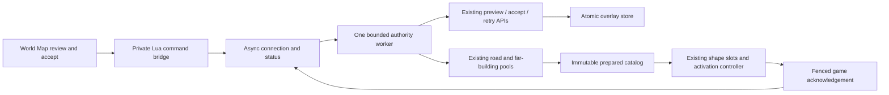

# Manual live OSM building overlays — Stage 5B2

For the simpler opt-in refresh-before-startup workflow, see
[Restart-based OSM buildings](RESTART_OSM_BUILDINGS.md). That mode uses ordinary
streaming from a fixed session snapshot and disables the live controls below.

Stage 5B2 connects the existing conservative merge, persistent store, controlled
retrieval, immutable mesh generations and building activation controller to the
World Map. This is an opt-in development feature. **No installed game was changed
or launched, and no live OSM request was made during implementation.** Engine
collision readiness and real game UI behavior still require Stage 6 verification.
The implementation starts from `37bc5f9` on `feature/live-osm-buildings`; no commit
or push was made during this stage.

The architecture remains immutable Overture data plus accepted OSM **building**
overlays. Roads, widths, lanes, terrain grading, bridges, sidewalks and props retain
their original sources. There is no OSM-authoritative road/building mode, automatic
OSM fetching, individual Overture suppression, Rust change or protocol-version bump.

## Using the map

1. Open the existing **World Map** from BeamNG.Earth's settings. Choose the separate
   **OSM buildings** action. Existing pre-cache controls remain available.
2. Choose **Choose building refresh area** and drag a box, or use the existing
   controller corner picker. Bounds use west, south, east, north order. The panel
   shows coordinates and approximate dimensions. Each dimension must be at most
   500 m; zoom in and select again if it is larger. Latitude is limited to ±85°;
   antimeridian-crossing selections are unsupported.
3. Choose **Fetch and preview buildings**. Opening the panel, selecting an area,
   driving, teleporting, reconnecting and local retry never request fresh OSM data.
4. Review the source replication timestamp, additions, matched replacements,
   unchanged records, conflicts, building parts, unsupported-source issues and
   retained Overture-only buildings. Expanded details identify footprint and
   attribute changes. Large detail lists are bounded and marked as shortened;
   totals describe the complete proposal. The original Stage 5A proposal/token is
   retained on the server, without recreating or modifying it for display.
5. Choose **Accept and apply these buildings** explicitly. Expired proposals,
   changed baselines, changed retrieval configuration and concurrent store edits
   require another preview. Acceptance also enables saved overlays, as stated in
   the preview. Omissions are never deletions; conflicts remain unresolved.
6. Watch accepted, preparing, prepared, scheduled, deferred, activating, retiring
   and activated states. A saved revision or generated file is not a successful
   game activation. Success requires the matching current game acknowledgement.
   Newly streamed dependent targets can show deferred status after an earlier
   target group completed; the last acknowledged revision remains identified.

**Retry locally** reuses accepted data and the existing preparation APIs, without
another OSM request. **Disable all overlays** keeps stored OSM data and prepares a
baseline handoff. **Enable saved overlays** prepares the saved data again.
**Rollback last accepted revision** uses the store's actual validated rollback;
it is unavailable when there is no history. These are global store operations,
not per-selection toggles. They require a second confirmation and the current
store-incarnation token. **Inspect / clean released resources** requests a fresh
game inventory and reports retained/uncertain resources as well as safe cleanup.

The World settings page also reports manual refresh availability. Missing local
configuration, offline fetching, permission failures, stale snapshots, Overpass
errors, quotas and unsafe handoffs are distinct from activation success.

## Local configuration and permission

Configuration comes from the companion process environment, not the map or a
committed configuration file. Nothing uses a public Overpass instance by default.
Set these variables in the process that launches the companion:

| Variable | Meaning |
| --- | --- |
| `BNGE_OSM_BUILDINGS=on` | Opt in to the live controller; defaults to off. |
| `BNGE_OSM_ENDPOINT` | Explicit HTTPS interpreter endpoint operated by you or permitted for this use. Required. |
| `BNGE_OSM_LOCAL_CONTROL=on` | Explicitly authorize manual writes from one local game. Defaults to off. |
| `BNGE_OSM_HEADERS` | Optional runtime JSON object of authentication headers, at most 8192 characters. Never include it in source, screenshots or reports. |
| `BNGE_OSM_SPACING_SECONDS` | Minimum request spacing, default 60; production configuration cannot lower it. |
| `BNGE_OSM_COOLDOWN_SECONDS` | Same-area cooldown, default 600; production configuration cannot lower it. |
| `BNGE_BUILDING_OVERLAY_DIR` | Existing optional explicit store directory. Otherwise opt-in uses `<cache-dir>/building-overlays`. |

Supply endpoint-specific stricter limits when needed. Existing `netfetch` offline
mode, denied-host policies, application User-Agent, single-request coordination,
Retry-After handling, streamed byte limits, timeouts and parser quotas remain in
force. A denied endpoint remains denied. There is no server rotation or insecure
HTTP switch in this production configuration. Credentials in the endpoint URL and
reserved/framing headers are rejected by the existing OSM client.

For example, in a separately authorized development companion process (no endpoint
is supplied by this example):

```powershell
$env:BNGE_OSM_BUILDINGS = 'on'
$env:BNGE_OSM_LOCAL_CONTROL = 'on'
$env:BNGE_OSM_ENDPOINT = Read-Host 'Your explicitly permitted HTTPS interpreter URL'
# Launch the separately approved development companion with buildings/roads enabled.
```

The control gate requires loopback, negotiated building controls and batching,
and a non-multiplayer hello. Write mode permits one game connection per companion.
The first permitted local game establishes a persistent non-secret client ID;
another client ID is refused for that companion lifetime. Lua persists that ID
through the engine settings API. Each hello rotates a random write capability
bound to the connection, session and epoch. It stays in a private Lua closure and
is absent from Vue status. Joining multiplayer revokes controls and stops new
background preparation. Existing ownership is retained until its release is proven.

This deliberately relies on the existing trusted local companion/game process
model. It is not authentication for a public server or for hostile local programs.
Do not expose the companion listener or forward its port to unrelated clients.
Use a separate companion/cache for another game. Losing the persisted client ID
can leave old session ownership uncertain; it does not authorize deleting it.

Commands have an operation allowlist, exact allowed fields, 4096-byte envelope,
2048-byte Lua payload, bounded/deduplicated IDs and a 250 ms command interval.
Store mutations require explicit confirmation; enable/disable/rollback also use
an atomic compare-and-swap inside the store writer lock. There are no UI fields
for endpoints, credentials, filesystem paths, arbitrary queries or executable code.
Errors exposed to the UI use fixed messages, rather than raw exceptions containing
endpoint credentials or local paths. Source provenance and ODbL attribution remain
in the store and generated building metadata; the panel also credits OSM.

Stopping the fetch/control opt-in does not delete or disable an explicitly
configured overlay store. To restore original buildings, use the revision-safe
disable operation. Ordinary defaults with no overlay configuration remain the
original building pipeline.

## Orchestration and target scheduling



The asyncio thread owns sockets, trackers, the pending-target map and an immutable
routing export. Blocking HTTP, baseline validation, store I/O, catalog hashing,
preparation, slot copying and activation-journal I/O run on one authority executor.
That worker uses copied connection/anchor descriptors and buffered sends. The
existing compute pools remain the mesh builders. Completed work reaches the real
connection only if its owner and geographic frame still match. Tracker deltas
retain exact Future identity fences. There is no second renderer or shape pool.

Startup building messages wait in a bounded queue until retained journal coverage
has been read off the event loop. This prevents stale building output escaping
before recovery fences exist. Reconnect/anchor changes discard only messages
positively known never to have crossed the socket; delivered resources remain
held. Preview accepts use the original Stage 5A token and `prepare=False`; local
retry validates durable accepted history before using current target discovery.
Default behavior of the older Python APIs is preserved.

### Catalog size is not message size

The prepared catalog still supports 128 targets. Activation validates that catalog
and selects relevant live targets in the current frame before imposing the wire
limit. A valid 128-entry catalog with one current target needs one normal message.
Old cached `info`/`skins` entries and historical global-tile caches are not current
targets in live discovery. Full registries can be replaced atomically without
first unioning old and new entries beyond the quota.

The **32-target message limit remains**. A larger current cohort is sent in at
most four `building_activate_batch` packets. Every part shares session, epoch,
anchor, sequence, transaction, publication and revision. The client validates each
packet, collects all parts and validates the assembled cohort before creating
objects. Missing, mismatched, late and superseded parts cannot install a subset.
Near/far/skyline and geographic representations therefore share one logical
handoff. A failed cohort is retried locally; accepted data is not lost.

There is at most one pending logical handoff. Limits are unchanged for 256 held
slots, 128 MiB copied per activation, 512 MiB retained activation assets, 32
transactions, 16 journal files and a 1 MiB logical activation message. Preparation
is capped at 128 targets, 512 dependency cells, 512 artifacts, 512 MiB total and
120 seconds per job. A cohort that exceeds a limit or includes an unsafe target
defers/fails visibly rather than bypassing quotas or installing mixed versions.

### Future tiles and revision fences

Normal building messages are checked against accepted footprints and retained
coverage. Unprepared building fields are withheld; unrelated content stays on the
normal pipeline. A bounded half-second controller discovers currently relevant
targets using actual rendering settings, density dependencies and geometry frames.
Collision-resident near targets are prepared first, followed by other near, far
and skyline targets. Existing generations are reused when input digests still
match. Disjoint rollback coverage uses retained cell components instead of treating
the entire bounding rectangle between distant edits as changed.

An unchanged failed/deferred scheduling signature does not continuously regenerate.
New streaming dependencies, movement, a changed store/anchor, positive releases or
explicit local retry provide new scheduling opportunities. Pending handoffs whose
targets leave the live tracker are cancelled through the existing protocol; a
handoff already retiring finishes its observable retirement safely. Future targets
are prepared from the latest accepted snapshot, with publication, input, generation
and store-incarnation checks. This background path never calls the OSM fetch API.

No explicit global cache version changed. As before, `revisit.code_key()` hashes
server Python source: deployment changes its namespace once, including when
overlays are off. Ordinary refresh/enable/disable/rollback does not repeat a global
invalidation. Relevant building dependency digests continue to scope local work.

## Collision, restart and ownership

The adapter modifies only `bld`, `bld2`, `bld3`, `bld4`, `bldcol` and corresponding
exact variants. It keeps original road/sidewalk/prop objects, queues and terrain.
Safety includes stationary vehicles, velocity margins and other collision foci.
It is checked before staging and throughout staging/readiness. A vehicle entering
then aborts the uncommitted change and preserves old buildings.

After commit, old building objects are queued for governed deletion and the new
colliders remain owned. If a vehicle approaches during retirement, the controller
finishes old collision retirement; it does not pull out the new colliders or
recreate old invisible obstacles. Cancellation cannot roll back an already
committed world. Road drops in managed tiles wait until collision foci are clear.

Readiness remains the Stage 5B1 observational criterion: required objects exist,
the governed collision reload has been observed, and two positive simulation
updates followed that observation. Retirement requires old objects absent, another
observed collision reload where applicable, and two further simulation updates.
Paused updates do not establish readiness. These checks **do not prove actual
engine contact/raycast readiness**. That is an explicit Stage 6 requirement.

Server restart retains older session files and journals. Current-frame legacy
tiles can hand off buildings while preserving occupied original road objects;
geographic tiles retain their established placement machinery. A differing legacy
frame defers new road replay and building installation until safe clearance.
Repeating hello, server handoff or extension reload does not imply file release.
An ordinary Lua extension reload reuses the existing road runtime/controller when
its scene group remains valid. A full Lua VM reset that loses ownership context
preserves the managed scene group and reports recovery blocked; it requires a
safe world reload, rather than guessing which roads can be removed.
Retaining a live runtime during an extension reload is not a hot code migration;
source updates should be tested in a fresh controlled development world.

### Proof-based cleanup

The store and generation catalog retain their checksummed JSON, atomic replacement,
writer locks, safe path checks and link rejection. Private work now has an OS lease
using the store's existing lock primitive. Both the physical worker and catalog
publication own that lease, including timeout/cancellation races. Unlocked work
with a validated marker can be reclaimed; legacy/unverifiable work stays retained.
Successful completion removes unused lease markers, avoiding accumulation across
retries. Cleanup traversals and deletion counts are bounded.

Before local preparation, a small collection pass compacts fully released terminal
history and removes unreferenced, unpublished generations. Publication and active,
pending, held or uncertain journal references are roots. Corrupt/incomplete journals
block generation reclamation. Published assets are never removed because of age.

Explicit cleanup obtains a random challenge/epoch/client/sequence-fenced inventory.
Lua scans TSStatic/TerrainBlock references under the existing governor, checks
stable scene identities and includes renderer queues, declared slots, sessions and
pending transactions. It fences/discards never-staged partial batches. A missing,
changing, over-quota or ownership-unknown inventory is incomplete and cannot release
resources. A timeout is not evidence.

Only a complete matching inventory can prove that unused delivered slots/older
sessions are unreferenced. Individual releases otherwise require exact slot and
serial receipts after object/collision retirement. Released pooled files are
removed only when their file identity/size/mtime still match and the existing pool
has no owner, waiting lease or hold. Reused slots cannot be deleted by an old receipt.
Old hold markers are removed only for recognized session directories, and their
directory retirement goes through the existing event-loop session deletion queue.

Pre-5B2 journals lack a client ID. A current game's empty inventory cannot prove
which game owned them, so they remain uncertain. Lost IDs, corrupt journals, lost
scene ownership and quota exhaustion require manual investigation. Do not remove
held files while a running game might still reference them. Overlay rollback history
and the last published catalog remain intentionally protected.

## Remaining limitations

- Actual engine collision contacts/raycasts, CDAE caching, frame budgets, Vue host
  callbacks and controller input still need the separately authorized Stage 6 run.
- A full VM reset with lost ownership stays blocked. Extension reload preserves
  runtime ownership; it does not migrate running objects to newly edited source.
- Pre-5B2 ownerless journals, corrupted metadata, a lost client ID or incomplete
  scene proof can require manual recovery. Age and disconnection never release them.
- One unsafe target can defer its coherent LOD cohort. Existing slot/byte/cell and
  target quotas remain; the controller does not bypass them or partially install
  mixed revisions to force progress.
- Preview requires the original processed baseline to be cached and valid. Existing
  geometry/part/multipolygon restrictions and conservative conflicts remain in force.
- Frozen application packaging and actual game installation are untested. Only the
  source, repository-local native fixtures, LuaJIT and Vue compilation were exercised.

## Changed files

Paths below are relative to the repository. Unlisted road/terrain source modules,
Rust, Stage 1 merge rules and Stage 3 transport/parser remain unchanged.

| File | Purpose |
| --- | --- |
| `server/buildinglive.py` (new) | Explicit local configuration/permission, bounded asynchronous authority, UI projections, stream scheduling and fenced cleanup orchestration. |
| `server/buildingretention.py` (new) | Work leases, journal validation, startup guard reads and proof-based generation/slot/session cleanup. |
| `server/buildingactivation.py` | Catalog/current-target distinction, bounded wire batches, exact-target ack fences, positive-release history compaction and copied routing support. |
| `server/buildingrefresh.py` | Atomic registry replacement, optional bounded preparation priority and worker/publication work leases. |
| `server/buildingtargets.py` | Optional current-only discovery, preserving older retained-registry discovery by default. |
| `server/buildingmanual.py` | Context-local copied discovery and optional acceptance/retry without immediately preparing; original defaults retained. |
| `server/buildingoverlaystore.py` | Optional expected-state CAS inside enable/disable/rollback writer locks. |
| `server/earthd.py` | Controller lifecycle, additive control/status/batch/inventory routing, slot receipts and compatible API forwarding. |
| `server/mapdata.py` | Explicit opt-in default overlay directory shared by normal and process-worker construction. |
| `mod/beamng_earth/lua/ge/extensions/beamngEarth/buildingui.lua` (new) | Private capability bridge, client identity and sanitized UI status. |
| `.../buildinginventory.lua` (new, same Lua directory) | Bounded governed scene/queue inventory; read-only proofs, not resource deletion. |
| `.../buildingactivation.lua` | Bounded batch assembly, extension reload continuity, progress phases and retirement-time safety observation. |
| `.../buildingadapter.lua` | Same-frame retained-tile handoff and preservation of road queues/ownership. |
| `.../roads.lua` | Existing renderer recovery, occupied-road protection, bounded deferred replay and inventory references. |
| `.../core.lua` | Capabilities, lifecycle handlers, controller/inventory updates and multiplayer revocation. |
| `.../settings.lua` | Existing settings-to-Lua bridge for cached status and commands. |
| `mod/beamng_earth/ui/ui-vue/mods/beamngEarth/EarthBuildingRefresh.vue` (new) | Review, explicit confirmation, progress, global disable/enable/rollback and resource diagnostics. |
| `.../buildingRefresh.js` (new, same UI directory) | Pure selection validation, state labels and bounded bridge encoding. |
| `.../EarthMap.vue` | Separate OSM action using the existing mouse/controller selection. |
| `.../earthSettingsStore.js` | Availability information in World settings. |
| `server/tests/test_buildinglive.py` (new) | Simulated JS/Lua/server workflow, permissions, stale previews/acks, streaming, retry, rollback, responsiveness and anchor/reconnect fences. |
| `server/tests/test_buildingbatches.py` (new) | 32/33/64/128 catalogs, relevant subset and mixed legacy/geographic LOD batches. |
| `server/tests/test_buildingretention.py` (new) | Rooted/uncertain assets, journals, release proofs, quotas and worker/publication race. |
| `server/tests/test_buildingrecovery.py` (new) | Repeated handoff, lost VM ownership, approach during retirement and governed inventories. |
| `server/tests/test_buildingactivation.py` | Preserve Stage 5B1 coverage; extension reload now retains its owned renderer instead of sweeping it. |
| `server/tests/lua/buildingactivation_trace.lua` | Existing deterministic engine harness dispatches batch packets. |
| `server/tests/test_protocol_agreement.py` | Additive message/hello schema checks; unrelated cache-enum failure preserved. |
| `tools/test_building_overlay.ps1` | Run all new suites in the existing pinned repository-local environment. |
| `tools/test_building_ui.ps1`, `tools/test_building_ui.mjs` (new) | Repository-local compiler bootstrap, pure UI checks and four Vue component compilations. |
| `tools/overlay-ui/package.json`, `package-lock.json` (new) | Lock `@vue/compiler-sfc` 3.5.22 and its dependency tree. |
| `README.md`, `server/README.md`, `docs/MANUAL_OSM_BUILDINGS.md`, `docs/BUILDING_ACTIVATION.md`, `docs/BUILDING_REGENERATION.md` | Point historical stage boundaries to the current opt-in workflow. |
| This document | User/configuration instructions, architecture, evidence, limitations and Stage 6 handoff. |

The existing `EarthSettingsPage.vue`, `EarthSettingsBody.vue` and UI `index.js`
already render/register the map and dynamic settings schema; they needed no edits.
Both settings components are still included in compilation checks.

## Reproducible local verification

From the repository in PowerShell:

```powershell
powershell -NoProfile -ExecutionPolicy Bypass -File tools/test_building_overlay.ps1
powershell -NoProfile -ExecutionPolicy Bypass -File tools/test_building_ui.ps1
```

Python uses the existing pinned CPython 3.12.10, NumPy 2.2.6, Pillow 11.3.0 and
Lupa 2.6 (`lupa.luajit21`) in `.venv/overlay-tests`. `-Bootstrap` is only needed for
the first Python dependency setup. The UI runner uses installed Node and a locked
repository-local Vue compiler in `.venv/overlay-ui`; its first run uses `npm ci`
with repository-local configuration/cache and scripts/audit disabled. No game
installation, system Python package install or Rust rebuild is involved.

All fixtures, temporary worlds, response mocks, caches and logs are repository-local.
The runner sets `BNGE_ROADGEO_REAL=0` before the legacy real-cache tests inspect a
path. Synthetic OSM responses are used throughout; no actual Overpass request is
performed. The end-to-end bridge test runs the real JS command encoder, real LuaJIT
bridge/controller/adapter/roads, actual merge/store and native mesh preparation,
with mocked HTTP and engine objects. It does not run BeamNG's physics or Vue host.

Execution on **2026-10-31**, starting from `37bc5f9`:

| Check | Actual result |
| --- | --- |
| Complete Python suite selection | **540 tests: 534 passed, 4 skipped, 1 failure, 1 error**, across 22 suites. |
| New Stage 5B2 tests | **32/32 passed**: 16 live workflow, 4 catalog/batch, 8 retention, 4 recovery. |
| Existing Stage 5B1 activation regression | **40/40 passed**. |
| Final focused live workflow recheck | **16/16 passed**, including the buffered stale-revision fence and a deterministically paused acknowledgement race. |
| UI checks | **21/21 passed**, including four Vue component script/template compilations; Node v24.22.0, compiler 3.5.22. |
| Syntax checks | **15 Python files and 8 Lua files passed**, including the large core Lua module. |
| `git diff --check` | Passed. No Rust changes or leftover fixture directories. |

The long run was interrupted after its first 18 suites; the remaining four were
resumed with the same pinned Python and local temporary-directory settings:

```powershell
$env:TMP = Join-Path (Get-Location).Path '.venv/overlay-tests/tmp'
$env:TEMP = $env:TMP
$env:BNGE_ROADGEO_REAL = '0'
foreach ($pattern in @('test_protocol_agreement.py', 'test_matslots.py', 'test_staging.py', 'test_roadgeo.py')) {
    & '.venv/overlay-tests/python/python.exe' -B -m unittest discover -s server/tests -p $pattern -v
}
```

The two established unrelated problems remain visible, with nonzero suite exit
codes; neither was fixed or converted to a skip:

- `test_roads.PaintRoadsTest.test_bare_verge_beside_roads`: native road-paint assertion,
  `9 != 0` (also established at the original checkpoint).
- `test_protocol_agreement.CacheAgreementTest.test_cache_in_the_mod`: the existing
  enum-oriented cache-setting regex gets `None`, then calls `.group()` on it.

Two skips require the external LuaJIT CLI; the required Lupa LuaJIT engine tests
ran. Two legacy real-cache road-geometry cases were explicitly opted out before
checking any external cache path. These are the same four skips as before.

Repository-local execution evidence lives in `.venv/overlay-tests/`:
`stage5b2-complete.log` (first 18 suites), `stage5b2-resumed.log` (last four),
`stage5b2-live-final.log`, `stage5b2-ui-final.log` and `stage5b2-results.json`.
The JSON tally does not count focused reruns twice. The ordinary complete runner
still returns nonzero for the two known problems.

Coverage includes all requested scenario groups:

| Scenarios | Evidence |
| --- | --- |
| 1–8: complete workflow, gates, stale preview, invalid areas, failures/offline, conflicts, retry, acceptance | `test_buildinglive`, plus unchanged Stage 1–5A tests. |
| 9–11: batching and LOD consistency | `test_buildingbatches` exercises 32/33/64/128, a 128-entry/one-live subset, and 33-target mixed legacy and geographic cohorts. |
| 12–17: future tiles, movement/revisit, rapid revisions, disable/rollback, concurrent streaming, rebase | `test_buildinglive`, existing Future identity/worker fencing and cross-cell/density tests. |
| 18–21: restart/reconnect/reload, vehicle approach, release ordering | `test_buildingrecovery`, `test_buildinglive`, retained Stage 5B1 Lua collision/slot tests. |
| 22–24: cleanup, corrupt/full journals, quotas | `test_buildingretention`, existing activation/generation/store resource tests. |
| 25–27: disabled compatibility, unrelated road/terrain inputs, regressions | Full existing overlay/render/blockworker/road/width/geotile/protocol suites. |

## Stage 6 handoff — instructions only

The user confirmed Stage 6D restoration and collision through repeated teleports,
then reached the retained-generation quota during a paused teleport. Stage 6E
adds proof-based batch capacity admission/reclamation without raising quotas;
the isolated kit and replay procedure are in
[STAGE6E_GENERATION_CAPACITY.md](STAGE6E_GENERATION_CAPACITY.md).
The user subsequently reported 16 successful Stage 6E restoration cycles,
including paused teleport, in BeamNG.drive 0.40.1: A remained about 6 m, C about
5 m; at the 512-generation limit 80 old generations were reclaimed and 80 new
ones created, with zero work directories left. Retiring states resolved
automatically. Both processes are closed. These are user-operated engine results;
Codex's automated acknowledgements remain simulated. Earlier handoff notes below
are historical.

The user confirmed Stage 6C live activation and collision in BeamNG.drive 0.40.1,
then found automatic restoration failed after teleport. The Stage 6D recovery
fix, evidence limits, baseline fallback and separate port/profile continuation
are in [STAGE6D_RESTORATION_FIX.md](STAGE6D_RESTORATION_FIX.md).
Actual engine teleport restoration with that fix remains pending.

The user-operated Stage 6B test also exposed governor starvation during building
staging. [The Stage 6C fix and isolated continuation procedure](STAGE6C_SCHEDULER_FIX.md)
document the confirmed mechanism and simulated regression evidence. Actual engine
activation/collision retesting of that fix remains pending.

The user-operated Stage 6B run found an empty-Lua-table preview rendering failure
in BeamNG.drive 0.40.1. The focused fix, runtime regression evidence and separate
kit/continuation procedure are in [STAGE6B_UI_FIX.md](STAGE6B_UI_FIX.md).
Actual in-game retesting of this fix remains pending.

Stage 6A preparation is now documented in [the isolated development test procedure](STAGE6A_MANUAL_TEST.md).
It provides repository-local artifacts and synthetic backend checks; no game has
been installed into or launched. The original Stage 5B2 handoff below remains the
engine-verification checklist. Actual in-game Stage 6 has not passed.

At the Stage 5B2 checkpoint, Stage 6 had **not** started. Do not install, launch a game, fetch live OSM, commit
or push as part of this stage. After separate authorization:

1. Review this diff and the two established unrelated test failures. Re-run the
   local checks. Record the checkpoint/dirty diff used for a development build.
2. Create an artifact inside the repository with the existing packager, for example
   `.venv/overlay-tests/python/python.exe -B tools/package.py --out .venv/stage6-build`.
   This only packages source; it does not install. The packager walks the mod/server
   trees, so the new Lua, Vue and Python modules are included. Verify the archive
   contents. No native rebuild is needed. Frozen-app packaging remains unverified.
3. Use a separately approved isolated development game profile, dedicated companion
   and disposable cache, not the user's normal installation/cache. First use fixed
   synthetic responses/local accepted fixtures. Configure a permitted real endpoint
   only for an independently approved network test, with the same quotas/policies.
4. Verify mouse/controller map selection, scrolling, Vue callbacks, configuration
   explanations, confirmations and stale-preview handling in the actual UI host.
   Check that credentials never appear in Vue state or logs.
5. Measure actual collision contacts and raycasts before/during/after handoff,
   including stationary/approaching vehicles, other foci, pause/resume, governor
   starvation and terrain reloads. Confirm hidden visuals, old collider removal,
   CDAE/TSStatic cache lifetime and exact slot release timing. Inspect reload counts.
6. Drive into/away/back; test near/far/skyline seams and geographic/legacy frames,
   rapid revisions, disable/enable/rollback and batches with a missing part. Check
   original road/terrain object identities and reject unsafe mixed generations.
7. Repeat companion restart, reconnect, extension reload and controlled level/VM
   reset. Confirm retained references appear in inventory, unknown ownership stays
   blocked and old sessions retire only after complete proof. Validate quotas and
   manual-intervention diagnostics without deleting uncertain live files.

Only actual Stage 6 engine observations can establish game-engine success.
