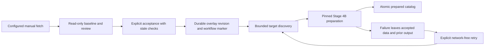

# Manual OSM building refresh (Stage 5A)

Stage 5A provides a server-side fetch, review, accept and prepare workflow. It uses
the immutable Overture baseline and the Stage 1–4B overlay/mesh architecture.
Prepared files are never activated in the game. No road source, Lua, protocol,
Rust, installed-game file or global cache version changes are involved.

That boundary describes Stage 5A alone. [Stage 5B1](BUILDING_ACTIVATION.md) now
provides a separate development-only activation call with revision fences,
building-only handoff and conservative collision/resource retirement. The full
manual refresh UI and automatic preparation of future streamed targets remain
Stage 5B2 work.

## Configuration and invocation

The existing server must have buildings enabled and a configured
`MapData._building_store`, as described in
[BUILDING_RENDER_OVERLAYS.md](BUILDING_RENDER_OVERLAYS.md). Near and distant
preparation use its existing road and far-building worker pools.

There is no default endpoint and no new command-line or network-protocol command.
An administrative Python caller supplies runtime configuration explicitly:

```python
import os
import osmbuildings

# Use an endpoint you operate or have permission to use. Configure its policy and
# credentials locally; do not put endpoint credentials in committed source files.
config = osmbuildings.Config(
    enabled=True,
    endpoint=os.environ["BNGE_OSM_ENDPOINT"],
    # Optional runtime authentication, only where required by your endpoint:
    # headers={"Authorization": os.environ["BNGE_OSM_AUTHORIZATION"]},
)
server.configure_osm_buildings(config)

# Longitude/latitude order: west, south, east, north. This example is about
# 370 x 440 m near Kenitra; substitute an explicitly chosen local selection.
bbox = (-6.5850, 34.2550, -6.5810, 34.2590)
preview = server.preview_osm_buildings(bbox, manual=True, enable=True)

# Review preview["changes"], ["issues"], ["merge"], ["spatial_diagnostics"],
# ["overture_only_details"] and the advisory ["generation_preview"].
# Acceptance is a separate, explicit call after that review:
accepted = server.accept_osm_buildings(preview["token"], manual=True)

# Inspect accepted["generation"]. A pending/no-target result preserves the edit.
# Retry performs no OSM building request and works after restarting the server:
retried = server.retry_osm_buildings(accepted["workflow_token"], manual=True)
```

`enable=True` is itself part of the reviewed proposal. Omitting it preserves a
disabled store's disabled state; saving data does not silently turn overlays on.
An already enabled store stays enabled. A disabled acceptance can prepare baseline
assets and reports `prepared_baseline` explicitly.

Only preview retrieves OSM building data. All three operations require `manual=True` and
one workflow operation may run at a time. Configuration while an operation is
busy is rejected. No operation is called automatically by driving/tile streaming.

The Stage 3 client retains the same `MapData.fetcher`, netfetch offline/denied-host
policy, application User-Agent, explicit endpoint validation, one-request lock,
60 s spacing, 600 s overlapping-area cooldown, Retry-After handling, timeouts and
streaming size limits. It never rotates servers. HTTPS is required by default.
HTTP opt-in remains a Stage 3 setting for explicitly permitted local services.
Request header values are excluded from reports, durable workflow markers and
public tokens; a private fingerprint detects credential/configuration changes.

## Original-baseline prerequisites and a pure preview

Preview reads **existing processed building/building-part NPZ cells** directly.
It does not call `MapData.cell()`, write mmap mirrors, warm a decoded LRU, create
the preparation catalog, or request Overture data. This avoids both hidden disk
writes and approval against a stale decoded cell.

Warm/repair missing cells explicitly through the ordinary baseline pipeline before
preview. Full parent footprints, neighboring cells, cross-cell parts and stored
override coverage must be available. A caller that already has a bounded warm
selection can use the existing API outside preview:

```python
import mapcells

# warm_bbox is an explicitly bounded context area, potentially larger than bbox.
w, s, e, n = warm_bbox
for key in mapcells.cells_for_bbox(s, w, n, e, max_cells=64):
    server.mapdata.cell(key, layers=("buildings", "building_parts"))
```

Warming may use the normal data/network pipeline; it is not part of a dry run.
The test fixtures warm synthetic cells locally without network access.

The collector closes over full incoming geometry, original parents/parts and
overlapping old entries, including disabled stored edits. It checks the original
release, cell provenance, geometry arrays, unsigned offsets, archive sizes and
NPY allocation sizes; pickle/object arrays are forbidden. Missing or inconsistent
cells, clipped selected geometry, absent declared parts, conflicting copies of
the same baseline ID and exceeded bounds fail explicitly. A legitimate empty cell
must contain a valid vector-layer representation, not a missing-data placeholder.

The context may grow beyond the small OSM selection to cover complete geometry.
It does not expand transitively through unrelated baseline neighbors. Defaults
are 64 cells, 512 selected original buildings/parts and 64 MiB total uncompressed
cell arrays, with 65,536 raw cached features and 1,000,000 raw vertices across the
context before selection. NPY zero-itemsize types cannot bypass allocation bounds.
A known OSM feature that moves beyond available context is rejected;
it is not treated as a harmless new building.

Completeness depends on the existing processed-cell contract: complete building
footprints and associated parts in their geographic coverage. There is no global
parent-to-part index or external source part-count proof. A missing outlying part
that violates that source contract cannot be inferred from locally present cells.
Incomplete incoming part sets remain conflicts under Stage 1's rules.

## Review and stale-preview protection

The deterministic report includes additions, replacements, retained buildings,
conflicts, known-ID issues, source replication time, before/after geometry,
attribute changes, parent part sets, provenance and automatic target diagnostics.
`changes` compares stored effective data before/after the merge, including stored
edits while disabled; `enabled_before` and `enabled_on_accept` describe visibility.
Returned report edits cannot change the server's cached proposal.

The review token hashes the selection/source data, public endpoint settings,
original context, file incarnations, store state and requested enabling. At most
four previews are retained for five minutes within a 64 MiB canonical-data budget.
Eviction, expiration or a process restart requires a new preview. These are local
approval/freshness tokens, not an authentication protocol for a future remote UI.

Acceptance checks the exact manifest state, original-file SHA-256/stat stamps,
baseline release, source age, observed replication watermark, configuration and
the complete reviewed merge digest **and decision report**. Local checks run under
the store writer lock, including again after immutable-object I/O and immediately
before manifest publication. Enable/disable/rollback ABA changes invalidate the
preview even when they return to the same content/enabled state.

The store's control manifest now accepts an optional random `incarnation` on each
real publication/recovery. It is excluded from immutable revision objects and
effective geometry digests. Existing manifests load without migration. Pre-5A
readers reject the new manifest field: downgrading a writer requires an explicit
compatibility procedure, not editing manifests while servers are running.

Freshness means a present replication timestamp within the configured maximum
age (one hour by default), no excessive future clock skew, no stale parser result,
and no newer timestamp observed by this client coordinator. It cannot prove that
OSM has not changed since fetch. Acceptance does not make a second request or
bypass cooldowns. Known IDs are included in the query; missing/retagged IDs produce
issues/conflicts and never justify deletion.

## Matching and Overture-only buildings

Exact normalized OSM identity remains authoritative for supported one-to-one
replacements. Different known OSM identities, split/merge graphs, overlapping
multiple candidates, unsupported shapes and unresolved parts retain the original
geometry and report conflicts.

The original same-vertex comparison remains. An additional bounded convex path
handles collinear/differently sampled outlines when exact planar IoU and relative
area are at least 0.98 and centroid/vertex-to-boundary distances remain inside the
existing 0.15 m tolerance, with a small guard below that threshold. A spatial-only
association retains the original footprint; it does not use proximity as authority
to replace geometry. Larger positional/tracing differences remain conflicts.

`buildingspatial` uses rational arithmetic over the actual input lon/lat doubles
for convex clipping, intersection, containment and area ratios. Reports provide
exact fraction strings in the stated lon/lat-plane model. Metre/area estimates
use an explicitly labeled approximate local affine projection. The symmetric
vertex-to-boundary field is not presented as a general polygon Hausdorff distance.
Concave/unsupported shapes and rings exceeding 32 vertices receive no overlap
score. No raster estimate, geometry repair or extra numerical dependency is used.
Diagnostics are bounded to 128 relevant pairs; exceeding the budget rejects the
preview rather than omitting conflicts silently.

An Overture-only footprint **always remains** by default. `overture_only` means
not associated with an incoming candidate in this response, not evidence that a
building is false. Details include its ID, original geometry/provenance and exact
baseline/part fingerprint. A valid empty response never deletes baseline or saved
overlay buildings. OSM attribution and original source provenance are retained
separately; original Overture cache files are never edited.

### Explicit false-positive correction is deferred

Schema 1 currently stores drawable polygon additions/overrides, not removal
operations. `_snapshot` validates that shape/status, `_apply` replaces records,
and the renderer projects every accepted entry. Using an attribute/status hack
would be unsafe: Stage 1's digest does not encode status, and future refreshes or
part composition could resurrect or inconsistently hide the building.

The minimal safe follow-up is a versioned, typed suppression entry containing:

1. An explicitly selected original GERS ID, baseline-release and full parent/part
   fingerprint, original geographic coverage, user reason and provenance.
2. A distinct operation kind in store validation, immutable revision hashes and
   local rendering dependency digests; strict migration/read compatibility.
3. Composition that removes that exact parent and its complete part set only
   after fingerprint validation, retaining the raw Overture records untouched.
4. Defined precedence against later OSM updates, with conflicts rather than silent
   resurrection, and old-coverage near/far/skyline/density target discovery.
5. Disable/rollback restoration and tests for stale IDs, part sets, boundaries,
   future refreshes, deterministic digests and prepared output in all LOD paths.

No suppression command is implemented in 5A. Automatic absence-based removal is
not a substitute for this operation.

## Discovery and preparation

`buildingtargets.discover()` combines the actual committed connection `.active`
anchors, near `roads.Tracker`/`GeoTracker`, distant/skyline `vegetation.Tracker`,
known far-geotile memo entries and the existing preparation registry. Originally
empty tiles and pending/retry targets count too. It uses
`blockworker.building_cells()` for the same density/context neighborhood as cache
identities, including cross-cell geometry and complete part-set coverage.

Legacy and geotile requests derive actual lift, sidewalks, driving side, units,
quality, buried fraction, lamps, country, gas-station settings and DEM zooms from
the server/anchor dispatch contracts. Distant geotiles are anchor independent.
Unchanged retained outputs remain registered and are reused. Stale anchor-bound
registry descriptors are retired from the next successfully published catalog;
their files remain on disk.
Reports distinguish `relevant_slots` from unrelated retained requests; unrelated
registry entries alone cannot claim preparation for the selected area.

Discovery visits at most eight connections, 16,384 tracker/memo keys, 512 area
cells and 128 candidate/retained targets. It does not scan the world cache or
invent active targets for tiles unknown to the trackers/registry. Changes during
iteration or quota exhaustion are explicit errors. `no_active_anchor` and
`no_corresponding_targets` have `prepared=False`; durable acceptance can still
succeed. Preview discovery is advisory and is repeated with current settings
after acceptance.

Stage 4B retains private generation directories, immutable resources, pinned
worker snapshots, mesh hashes, catalog sequence fencing and local dependency
reuse. 5A additionally fences planning and publication against the **exact
accepted store state**, including enable/disable/rollback. Publication cannot
silently substitute a newer revision, even if it happens to render similarly.

No refresh changes a global version, releases the baseline, or clears unrelated
caches. As in Stage 4A, deploying changed Python source changes the pre-existing
`revisit.code_key()` source fingerprint. This implementation does not bypass that
normal code-upgrade behavior. Selective reuse applies within a compatible code
fingerprint; runtime overlay edits do not change it.

## Separate durability, lock order and recovery



Storage acceptance and catalog publication are **two durable operations**. The
marker stored in refresh metadata includes the workflow token, original selection,
context bounds, source time and baseline digest. No automatic rollback follows a
preparation failure. Prior prepared entries/files remain usable; an uncertain
post-swap/fsync error can leave a published state despite an exception.

Acceptance reports `acceptance_not_confirmed` for a storage I/O failure and does
not start preparation. Inspect the current accepted markers before retrying. A
durable marker, not the exception's timing, establishes whether acceptance exists:

```python
# No endpoint is needed to inspect/retry existing accepted work after restart.
workflow = server._manual_building_workflow(retry=True)
markers = workflow.accepted()
result = server.retry_osm_buildings(markers[0]["token"], manual=True)
```

Supply an explicit token if multiple operations exist. Retry loads one current
snapshot and its state token, checks the marker and prepares that current state;
it never replays fetched data over newer edits. If rollback removes the marker,
retry fails explicitly. Disabled state prepares baseline output. Unaccepted
previews are intentionally not persisted.

Network-free retry refers to reusing accepted OSM building data. Ordinary mesh
generation still uses its existing baseline/road-tag/DEM/imagery pipeline and may
need those inputs if uncached. For wholly offline preparation, cache them first
and retain netfetch's offline policy. The integration fixtures supply all of them
locally; no test makes a live request.

Acceptance holds the OSM coordinator lock and then the store writer lock for
local validation/publication, with no HTTP or catalog acquisition inside them.
Both locks are released before discovery/preparation. Stage 4B continues to take
catalog then store locks at planning/publication. It never calls back into the
manual operation lock. This avoids a store-to-catalog lock inversion.

## Retention and capacity

Existing quotas are unchanged: overlay JSON 8 MiB/document, 64 MiB total, 128
revision objects, 128 distinct refresh records, 2,048 entries including parts and
2,048 conflicts. A reviewed metadata-only acceptance can consume history even
when effective mesh geometry is unchanged.
Quota scans also bound direct filesystem entries to `2 * max_revisions + 16`
(272 by default), reserving space for in-flight atomic writes. Zero-byte crash
temporaries count too; a repeated crash cannot evade byte/revision quotas with
unbounded empty temporary files. Reaching this guard stops work without deleting
history, referenced data or uncertain files.

Prepared generations retain Stage 4B limits: 128 registered targets, 512 changed
cells, two refresh callers/jobs, 512 retained/work generations, 128 files/job,
64 MiB/file, 128 MiB/job, 512 MiB retained/work bytes, 4 MiB catalog and 120 s/job.
The temporary registry union of old/new targets must also fit 128 so failure can
retain the prior valid catalog. Replacing a full registry may therefore require
future retirement tooling rather than silently evicting referenced entries.

Normal failures clean private work only after its worker finishes. Interrupted
processes can leave work directories; uncertain object/catalog publication can
leave immutable orphans. These remain counted against quotas and can block new
work. No garbage collector guesses whether the game holds a resource. Referenced,
retired and potentially held generation files are never automatically deleted.
Capacity exhaustion preserves existing data/output and requires explicit safe
administration or the Stage 5B lifetime protocol.

## Offline verification and recorded results

Use the existing repository-local pinned CPython 3.12.10 / NumPy 2.2.6 / Pillow
11.3.0 environment and checked-in Windows native binary. No bootstrap/download,
live OSM request or Rust rebuild is required for these commands:

```powershell
# Full Stage 1–4B + 5A and existing renderer/roads/geometry regressions:
powershell.exe -NoProfile -ExecutionPolicy Bypass -File tools/test_building_overlay.ps1

# Focused Stage 5A verification from the repository root:
$env:TMP = Join-Path (Get-Location).Path '.venv/overlay-tests/tmp'
$env:TEMP = $env:TMP
& '.venv/overlay-tests/python/python.exe' -B -m unittest discover -s server/tests -p test_buildingmanual.py -v
```

The focused tests mock the HTTP transport while exercising the real OSM client,
processed-cell serialization, store, tracker discovery, native mesher, catalog
and a restarted real Server with a spawned worker. All fixtures/artifacts stay
inside the repository. The first integration case produces an actual building
`.cdae` mesh from an empty baseline through fetch/preview/accept/discovery/prepare.

Recorded 5A results: **43 new tests pass**. The full runner executes **401 tests:
399 pass, one fails, one skips** and exits **1**, not success. The unchanged known
failure is `test_roads.PaintRoadsTest.test_bare_verge_beside_roads` (`9 != 0`).
`test_geotiles.LuaAgreementTest.test_agrees` retains its skip for unavailable
`luajit`. All Stage 1–4B overlay suites pass. The old collinear-vertex Stage 1
expectation is intentionally updated from conflict to the newly proven spatial
association, explicitly asserting that original geometry is retained.

Coverage includes A–V from the request: additions/identity changes, exact and
offset/differently sampled outlines, ambiguous/partial overlaps, known identity
conflicts, omission/retagging/replication failures, unsupported shapes/parts,
missing/malformed/clipped baseline context, boundary/density dependencies,
unrelated reuse, zero-write previews, stale/ABA/concurrent changes, post-acceptance
failure, uncertain storage publication, network-free retry/restart, real worker
recreation, feature-off bytes and baseline road/terrain inputs. Additional tests
cover review-data isolation and a baseline mutation during object writing.

## Remaining work

**Operational blockers:** insufficient original cached context, stale/incomplete
source data, unavailable/denied/offline endpoint, missing worker pools and exhausted
quotas fail explicitly. No active/corresponding targets prevent asset preparation,
not durable storage acceptance. Fix context/settings/capacity and retry as appropriate.

**Deferred improvements:** typed per-GERS suppression above; complete robust
measurements for general concave/multipolygon shapes; explicit human conflict
resolution; a trustworthy global part-completeness index; baseline warm UX and
backup/export/retention tooling. Larger spatial differences remain conflicts
rather than being accepted using a larger tolerance.

**Stage 5B prerequisites:** administrative/manual selection and confirmation UI,
authorization for any newly exposed command, final current-dependency validation,
immutable resource/VFS relocation, generation-fenced tracker callbacks, coordinated
near/far/skyline visual and collision activation, source attribution, resource
holds and client acknowledgment before retirement/collection. The installed game
must not receive prepared assets until that lifetime/activation protocol exists.
Stage 5A does not implement or start any of these operations.

## Files changed in Stage 5A

| File | Purpose |
| --- | --- |
| [buildingmanual.py](../server/buildingmanual.py) | Bounded manual workflow, review reports/tokens, freshness/CAS guards, durable acceptance and retry. |
| [buildingbaseline.py](../server/buildingbaseline.py) | Read-only bounded original-cache context and file/geometry validation. |
| [buildingtargets.py](../server/buildingtargets.py) | Actual tracker/anchor/settings discovery and retained-target retirement metadata. |
| [buildingspatial.py](../server/buildingspatial.py) | Exact convex planar measurements, labeled metre estimates and narrow equivalence evidence. |
| [buildingoverlay.py](../server/buildingoverlay.py) | Add the bounded equivalence path while preserving identity/conflict/part rules and baseline geometry. |
| [buildingoverlaystore.py](../server/buildingoverlaystore.py) | Pure dry run, exact state/decision guards, optional explicit enable, commit receipt and manifest incarnation. |
| [buildingrefresh.py](../server/buildingrefresh.py) | Read-only registry access, accepted-state fencing and atomic desired-registry replacement. |
| [earthd.py](../server/earthd.py) | Explicit configuration/preview/accept/retry APIs and preparation guard forwarding. |
| [test_buildingmanual.py](../server/tests/test_buildingmanual.py) | Synthetic end-to-end and spatial/recovery/concurrency regression tests. |
| [test_buildingoverlay.py](../server/tests/test_buildingoverlay.py) | Update the collinear-vertex expectation with geometry-retention assertions. |
| [test_building_overlay.ps1](../tools/test_building_overlay.ps1) | Include the Stage 5A suite without hiding nonzero results or changing pins. |
| [BUILDING_OVERLAYS.md](BUILDING_OVERLAYS.md) | Document the storage extensions and backward-read/downgrade contract. |
| [BUILDING_REGENERATION.md](BUILDING_REGENERATION.md) | Connect Stage 4B preparation to 5A discovery and retain the activation/retention boundary. |
| [server README](../server/README.md) | Link the manual workflow and clarify the Stage 5B boundary. |
| This document | Configuration, architecture, exact verification, results and outstanding work. |
